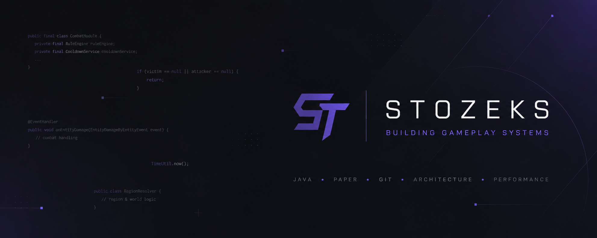

  

<h1 align="center">
Alexander (Stozeks)
</h1>

Engine Developer • Java • Paper

Building gameplay systems with clean architecture.

---

# About

I design scalable gameplay systems for Paper servers.

Currently building **AnarchyRuleEngine** — a modular engine focused on combat mechanics, custom items, region interaction and server performance.

I enjoy turning complex gameplay ideas into maintainable and extensible code.

---

# Current Project

## ⚡ AnarchyRuleEngine

A modular engine powering an anarchy server.

### Implemented

- Combat System
- Combat Logging
- Custom Items
- Plast
- Trap
- Beacon Pulse
- WorldGuard Integration
- Rule Engine
- Cooldown Manager

### In Progress

- Region Protection
- Events Module
- Economy Integration
- Statistics System

---

# Tech Stack

- Java
- Maven
- Paper API
- WorldGuard
- Git
- IntelliJ IDEA

---

# Philosophy

> Build systems that are easy to extend,
> not code that is easy to write.

---

*"Good architecture is invisible until you need to change something."*

